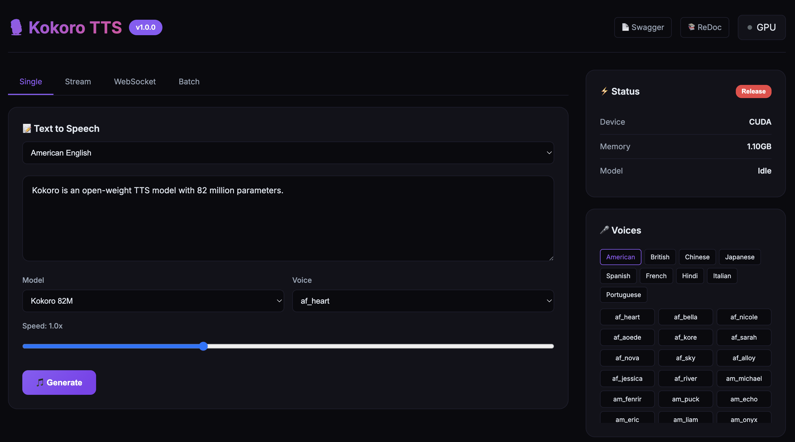

[English](README.md) | [简体中文](README_CN.md) | [繁體中文](README_TW.md) | [日本語](README_JP.md)

<div align="center">

# 🎙️ Kokoro TTS

[](https://hub.docker.com/r/neosun/kokoro-tts)
[](LICENSE)
[](https://python.org)
[](https://huggingface.co/hexgrad/Kokoro-82M)

**All-in-One Docker image for Kokoro-82M Text-to-Speech**

Web UI • REST API • WebSocket • Streaming • Batch • MCP



</div>

---

## ✨ Features

- 🎨 **Beautiful Web UI** - Modern interface with real-time audio playback
- 🔌 **REST API** - Full-featured HTTP endpoints with Swagger docs
- 📡 **WebSocket** - Real-time bidirectional TTS communication
- 🌊 **Streaming** - Audio chunks delivered as they generate
- 📦 **Batch Processing** - Process multiple texts in one request
- 🤖 **MCP Server** - AI agent integration (Claude, etc.)
- 🌍 **Multi-language** - English, Chinese, Japanese, Spanish, French, Hindi, Italian, Portuguese
- 🚀 **GPU Accelerated** - CUDA support with automatic memory management
- 📱 **54+ Voices** - Wide variety of male and female voices

## 🚀 Quick Start

```bash
docker run -d --name kokoro-tts --gpus all -p 8300:8300 neosun/kokoro-tts:latest
```

Open http://localhost:8300 in your browser.

## 📦 Installation

### Prerequisites

- Docker 20.10+
- NVIDIA GPU with CUDA support (optional, CPU fallback available)
- nvidia-docker2 (for GPU support)

### Docker Run

```bash
# With GPU
docker run -d \
  --name kokoro-tts \
  --gpus all \
  -p 8300:8300 \
  -e GPU_IDLE_TIMEOUT=600 \
  --restart unless-stopped \
  neosun/kokoro-tts:latest

# CPU only
docker run -d \
  --name kokoro-tts \
  -p 8300:8300 \
  --restart unless-stopped \
  neosun/kokoro-tts:latest
```

### Docker Compose

```yaml
services:
  kokoro-tts:
    image: neosun/kokoro-tts:latest
    container_name: kokoro-tts
    ports:
      - "8300:8300"
    environment:
      - GPU_IDLE_TIMEOUT=600
      - KEEP_MODEL_LOADED=true  # Never release model from memory
    deploy:
      resources:
        reservations:
          devices:
            - driver: nvidia
              count: 1
              capabilities: [gpu]
    restart: unless-stopped
```

```bash
docker-compose up -d
```

### Verify Installation

```bash
# Health check
curl http://localhost:8300/health

# Generate speech
curl -X POST http://localhost:8300/api/tts \
  -H "Content-Type: application/json" \
  -d '{"text":"Hello world","voice":"af_heart"}' \
  -o output.wav
```

## ⚙️ Configuration

| Variable | Default | Description |
|----------|---------|-------------|
| `PORT` | `8300` | Server port |
| `GPU_IDLE_TIMEOUT` | `300` | Seconds before GPU memory release |
| `KEEP_MODEL_LOADED` | `false` | Never release model from memory (set to `true` for lowest latency) |
| `NVIDIA_VISIBLE_DEVICES` | `all` | GPU device selection |

## 📖 Usage

### Web UI

| Tab | Description |
|-----|-------------|
| **Single** | Generate single audio file |
| **Stream** | Real-time streaming playback |
| **WebSocket** | Bidirectional real-time TTS |
| **Batch** | Process multiple texts at once |

### REST API

#### Generate Speech (WAV)
```bash
curl -X POST http://localhost:8300/api/tts \
  -H "Content-Type: application/json" \
  -d '{"text":"Hello world","voice":"af_heart","speed":1.0}' \
  -o output.wav
```

#### Generate Speech (Base64)
```bash
curl -X POST http://localhost:8300/api/tts/base64 \
  -H "Content-Type: application/json" \
  -d '{"text":"Hello world","voice":"af_heart","speed":1.0}'
```

#### Streaming
```bash
curl -X POST http://localhost:8300/api/tts/stream \
  -H "Content-Type: application/json" \
  -d '{"text":"Long text here...","voice":"af_heart"}'
```

#### Batch Processing
```bash
curl -X POST http://localhost:8300/api/tts/batch \
  -H "Content-Type: application/json" \
  -d '{
    "items": [
      {"id":"1","text":"First","voice":"af_heart"},
      {"id":"2","text":"Second","voice":"am_michael"}
    ]
  }'
```

### WebSocket

```javascript
const ws = new WebSocket('ws://localhost:8300/ws/tts');
ws.onopen = () => {
  ws.send(JSON.stringify({
    text: "Hello world",
    voice: "af_heart",
    speed: 1.0
  }));
};
ws.onmessage = (e) => {
  const data = JSON.parse(e.data);
  if (data.status === 'chunk') {
    // Play audio: data.audio (base64)
  }
};
```

### MCP Integration

```json
{
  "mcpServers": {
    "kokoro-tts": {
      "command": "docker",
      "args": ["exec", "-i", "kokoro-tts", "python", "/app/docker/server.py", "mcp"]
    }
  }
}
```

## 🎤 Available Voices

### Models

| Model | Languages | Voices | Best For |
|-------|-----------|--------|----------|
| `hexgrad/Kokoro-82M` | 9 | 54 | General use |
| `hexgrad/Kokoro-82M-v1.1-zh` | 3 | 103 | Chinese optimized |

### Voice Examples

| Language | Female | Male |
|----------|--------|------|
| 🇺🇸 American English | af_heart, af_bella, af_nicole | am_michael, am_fenrir |
| 🇬🇧 British English | bf_emma, bf_isabella | bm_george, bm_fable |
| 🇨🇳 Chinese | zf_xiaobei, zf_xiaoyi | zm_yunjian, zm_yunyang |
| 🇯🇵 Japanese | jf_alpha, jf_tebukuro | jm_kumo |
| 🇪🇸 Spanish | ef_dora | em_alex |
| 🇫🇷 French | ff_siwis | - |

## 📚 API Documentation

- **Swagger UI**: http://localhost:8300/docs
- **ReDoc**: http://localhost:8300/redoc

## 🏗️ Project Structure

```
kokoro/
├── docker/
│   ├── server.py        # FastAPI server
│   ├── ui_template.py   # Web UI
│   └── mcp_server.py    # MCP tools
├── kokoro/              # Core TTS library
├── Dockerfile
├── docker-compose.yml
└── README.md
```

## 🛠️ Tech Stack

- **Backend**: FastAPI, Uvicorn
- **TTS Engine**: Kokoro-82M (StyleTTS 2)
- **Deep Learning**: PyTorch, CUDA
- **Container**: Docker, NVIDIA Container Toolkit

## 🤝 Contributing

Contributions are welcome! Please feel free to submit a Pull Request.

1. Fork the repository
2. Create your feature branch (`git checkout -b feature/amazing`)
3. Commit your changes (`git commit -m 'Add amazing feature'`)
4. Push to the branch (`git push origin feature/amazing`)
5. Open a Pull Request

## 📖 Documentation

- [Streaming Optimization Guide](docs/STREAMING_OPTIMIZATION.md) - How we reduced latency from 2s to 50ms

## 📝 Changelog

### v1.1.1 (2025-01) - 🔒 Keep Model Loaded

**🆕 New Features**
- Added `KEEP_MODEL_LOADED` environment variable
- When set to `true`, model stays in GPU memory permanently
- Eliminates cold start delay completely for consistent 51ms TTFB

**📊 Latest Performance (2025-01-29)**
- Local TTFB: **51-53ms** (stable)
- Cloudflare TTFB: **138-178ms**
- First chunk: **54ms, 71.5KB**

### v1.1.0 (2025-01) - 🚀 Streaming Latency Optimization

**⚡ Major Performance Improvements**
- **40x faster first play** - Reduced from 2s+ to ~50ms
- **6x smaller first chunk** - Reduced from 436KB to 71.5KB
- **10x faster TTFB** - Reduced from ~500ms to ~50ms (local)

**🔧 Backend Optimizations**
- Split audio by sentence/clause (`[.!?。！？,，;；:：]+`) instead of newline
- Model warmup on startup - eliminates cold start delay (93ms → 56ms)
- Added `X-Accel-Buffering: no` and `Cache-Control: no-cache` headers
- Streaming chunks now generated per sentence for immediate delivery

**🎨 Frontend Optimizations**
- Non-blocking audio decoding with `.then()` instead of `await`
- AudioContext auto-resume for browser autoplay policy
- Immediate playback when first chunk decoded
- Parallel chunk receiving and audio decoding

**📊 Performance Metrics Panel** (Stream tab)
- Time to First Byte (TTFB) - measures server response time
- Time to First Play - measures actual audio start time
- Total Time - real-time elapsed time counter
- Data Size - total bytes received

**🎛️ UI Enhancements**
- Added Model selector to Stream, WebSocket, Batch tabs
- Added Voice selector to Stream, WebSocket, Batch tabs  
- Added Speed slider to Stream, WebSocket, Batch tabs
- Real-time metrics update during streaming
- Improved status indicators and toast notifications

**🐛 Bug Fixes**
- Fixed WebSocket `sendWS()` using wrong model selector
- Fixed Batch tab missing audio playback controls
- Fixed version number display in UI footer

### v1.0.0 (2025-01) - 🎉 Initial Release

**✨ Core Features**
- Beautiful Web UI with 4 tabs (Single, Stream, WebSocket, Batch)
- Full-featured REST API with Swagger/ReDoc documentation
- WebSocket real-time bidirectional TTS
- Streaming audio delivery as chunks generate
- Batch processing for multiple texts

**🤖 AI Integration**
- MCP Server for AI agent integration (Claude, Cursor, etc.)
- Tool-based TTS generation for AI workflows

**🌍 Multi-language Support**
- 9 languages: English, Chinese, Japanese, Spanish, French, Hindi, Italian, Portuguese, Korean
- 54+ voices with male and female options
- Multi-model support: Kokoro-82M (general) and Kokoro-82M-v1.1-zh (Chinese optimized)

**🚀 Infrastructure**
- GPU accelerated with CUDA support
- Automatic GPU memory management with configurable idle timeout
- CPU fallback when GPU unavailable
- Docker containerized deployment

### v1.0.0 (2025-01) - 🎉 Initial Release

**✨ Core Features**
- Beautiful Web UI with 4 tabs (Single, Stream, WebSocket, Batch)
- Full-featured REST API with Swagger/ReDoc documentation
- WebSocket real-time bidirectional TTS
- Streaming audio delivery as chunks generate
- Batch processing for multiple texts

**🤖 AI Integration**
- MCP Server for AI agent integration (Claude, Cursor, etc.)
- Tool-based TTS generation for AI workflows

**🌍 Multi-language Support**
- 9 languages: English, Chinese, Japanese, Spanish, French, Hindi, Italian, Portuguese, Korean
- 54+ voices with male and female options
- Multi-model support: Kokoro-82M (general) and Kokoro-82M-v1.1-zh (Chinese optimized)

**🚀 Infrastructure**
- GPU accelerated with CUDA support
- Automatic GPU memory management with configurable idle timeout
- CPU fallback when GPU unavailable
- Docker containerized deployment

## 📄 License

This project is licensed under the Apache License 2.0 - see the [LICENSE](LICENSE) file for details.

## 🙏 Acknowledgements

- [hexgrad/Kokoro-82M](https://huggingface.co/hexgrad/Kokoro-82M) - The amazing TTS model
- [StyleTTS 2](https://github.com/yl4579/StyleTTS2) - Model architecture

---

## ⭐ Star History

[](https://star-history.com/#neosun100/kokoro-tts)

## 📱 Follow Us


