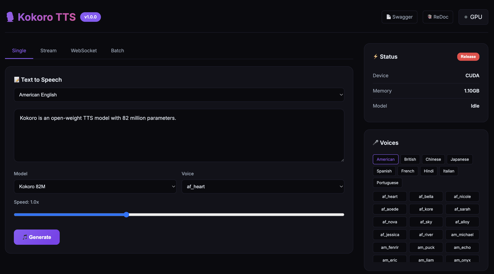

[English](README.md) | [简体中文](README_CN.md) | [繁體中文](README_TW.md) | [日本語](README_JP.md)

<div align="center">

# 🎙️ Kokoro TTS

[](https://hub.docker.com/r/neosun/kokoro-tts)
[](LICENSE)
[](https://python.org)
[](https://huggingface.co/hexgrad/Kokoro-82M)

**Kokoro-82M 文本转语音 All-in-One Docker 镜像**

Web UI • REST API • WebSocket • 流式传输 • 批量处理 • MCP



</div>

---

## ✨ 功能特性

- 🎨 **精美 Web UI** - 现代化界面，支持实时音频播放
- 🔌 **REST API** - 完整的 HTTP 接口，带 Swagger 文档
- 📡 **WebSocket** - 实时双向 TTS 通信
- 🌊 **流式传输** - 边生成边播放音频
- 📦 **批量处理** - 一次请求处理多段文本
- 🤖 **MCP 服务器** - AI 代理集成（Claude 等）
- 🌍 **多语言支持** - 英语、中文、日语、西班牙语、法语、印地语、意大利语、葡萄牙语
- 🚀 **GPU 加速** - CUDA 支持，自动内存管理
- 📱 **54+ 语音** - 丰富的男女声音选择

## 🚀 快速开始

```bash
docker run -d --name kokoro-tts --gpus all -p 8300:8300 neosun/kokoro-tts:latest
```

在浏览器中打开 http://localhost:8300

## 📦 安装部署

### 前置条件

- Docker 20.10+
- NVIDIA GPU（可选，支持 CPU 运行）
- nvidia-docker2（GPU 支持需要）

### Docker 运行

```bash
# GPU 模式
docker run -d \
  --name kokoro-tts \
  --gpus all \
  -p 8300:8300 \
  -e GPU_IDLE_TIMEOUT=600 \
  --restart unless-stopped \
  neosun/kokoro-tts:latest

# CPU 模式
docker run -d \
  --name kokoro-tts \
  -p 8300:8300 \
  --restart unless-stopped \
  neosun/kokoro-tts:latest
```

### Docker Compose

```yaml
services:
  kokoro-tts:
    image: neosun/kokoro-tts:latest
    container_name: kokoro-tts
    ports:
      - "8300:8300"
    environment:
      - GPU_IDLE_TIMEOUT=600
      - KEEP_MODEL_LOADED=true  # 永不释放模型
    deploy:
      resources:
        reservations:
          devices:
            - driver: nvidia
              count: 1
              capabilities: [gpu]
    restart: unless-stopped
```

```bash
docker-compose up -d
```

### 验证安装

```bash
# 健康检查
curl http://localhost:8300/health

# 生成语音
curl -X POST http://localhost:8300/api/tts \
  -H "Content-Type: application/json" \
  -d '{"text":"你好世界","voice":"zf_xiaobei"}' \
  -o output.wav
```

## ⚙️ 配置说明

| 变量 | 默认值 | 说明 |
|------|--------|------|
| `PORT` | `8300` | 服务端口 |
| `GPU_IDLE_TIMEOUT` | `300` | GPU 空闲释放时间（秒） |
| `KEEP_MODEL_LOADED` | `false` | 永不释放模型（设为 `true` 获得最低延迟） |
| `NVIDIA_VISIBLE_DEVICES` | `all` | GPU 设备选择 |

## 📖 使用方法

### Web UI

| 标签页 | 说明 |
|--------|------|
| **Single** | 生成单个音频文件 |
| **Stream** | 实时流式播放 |
| **WebSocket** | 双向实时 TTS |
| **Batch** | 批量处理多段文本 |

### REST API

#### 生成语音（WAV）
```bash
curl -X POST http://localhost:8300/api/tts \
  -H "Content-Type: application/json" \
  -d '{"text":"你好世界","voice":"zf_xiaobei","speed":1.0}' \
  -o output.wav
```

#### 生成语音（Base64）
```bash
curl -X POST http://localhost:8300/api/tts/base64 \
  -H "Content-Type: application/json" \
  -d '{"text":"你好世界","voice":"zf_xiaobei","speed":1.0}'
```

#### 流式传输
```bash
curl -X POST http://localhost:8300/api/tts/stream \
  -H "Content-Type: application/json" \
  -d '{"text":"这是一段很长的文本...","voice":"zf_xiaobei"}'
```

#### 批量处理
```bash
curl -X POST http://localhost:8300/api/tts/batch \
  -H "Content-Type: application/json" \
  -d '{
    "items": [
      {"id":"1","text":"第一句","voice":"zf_xiaobei"},
      {"id":"2","text":"第二句","voice":"zm_yunjian"}
    ]
  }'
```

### WebSocket

```javascript
const ws = new WebSocket('ws://localhost:8300/ws/tts');
ws.onopen = () => {
  ws.send(JSON.stringify({
    text: "你好世界",
    voice: "zf_xiaobei",
    speed: 1.0
  }));
};
ws.onmessage = (e) => {
  const data = JSON.parse(e.data);
  if (data.status === 'chunk') {
    // 播放音频: data.audio (base64)
  }
};
```

### MCP 集成

```json
{
  "mcpServers": {
    "kokoro-tts": {
      "command": "docker",
      "args": ["exec", "-i", "kokoro-tts", "python", "/app/docker/server.py", "mcp"]
    }
  }
}
```

## 🎤 可用语音

### 模型

| 模型 | 语言数 | 语音数 | 适用场景 |
|------|--------|--------|----------|
| `hexgrad/Kokoro-82M` | 9 | 54 | 通用场景 |
| `hexgrad/Kokoro-82M-v1.1-zh` | 3 | 103 | 中文优化 |

### 语音示例

| 语言 | 女声 | 男声 |
|------|------|------|
| 🇺🇸 美式英语 | af_heart, af_bella, af_nicole | am_michael, am_fenrir |
| 🇬🇧 英式英语 | bf_emma, bf_isabella | bm_george, bm_fable |
| 🇨🇳 中文 | zf_xiaobei, zf_xiaoyi | zm_yunjian, zm_yunyang |
| 🇯🇵 日语 | jf_alpha, jf_tebukuro | jm_kumo |
| 🇪🇸 西班牙语 | ef_dora | em_alex |
| 🇫🇷 法语 | ff_siwis | - |

## 📚 API 文档

- **Swagger UI**: http://localhost:8300/docs
- **ReDoc**: http://localhost:8300/redoc

## 🏗️ 项目结构

```
kokoro/
├── docker/
│   ├── server.py        # FastAPI 服务器
│   ├── ui_template.py   # Web UI
│   └── mcp_server.py    # MCP 工具
├── kokoro/              # 核心 TTS 库
├── Dockerfile
├── docker-compose.yml
└── README.md
```

## 🛠️ 技术栈

- **后端**: FastAPI, Uvicorn
- **TTS 引擎**: Kokoro-82M (StyleTTS 2)
- **深度学习**: PyTorch, CUDA
- **容器化**: Docker, NVIDIA Container Toolkit

## 🤝 贡献指南

欢迎贡献！请随时提交 Pull Request。

1. Fork 本仓库
2. 创建功能分支 (`git checkout -b feature/amazing`)
3. 提交更改 (`git commit -m '添加新功能'`)
4. 推送到分支 (`git push origin feature/amazing`)
5. 创建 Pull Request

## 📖 文档

- [流式延迟优化指南](docs/STREAMING_OPTIMIZATION.md) - 如何将延迟从 2s 降低到 50ms

## 📝 更新日志

### v1.1.1 (2025-01) - 🔒 模型常驻内存

**🆕 新功能**
- 新增 `KEEP_MODEL_LOADED` 环境变量
- 设为 `true` 时，模型永久驻留 GPU 内存
- 完全消除冷启动延迟，稳定 51ms TTFB

**📊 最新性能数据 (2025-01-29)**
- 本地 TTFB：**51-53ms**（稳定）
- Cloudflare TTFB：**138-178ms**
- 首 Chunk：**54ms, 71.5KB**

### v1.1.0 (2025-01) - 🚀 流式延迟优化

**⚡ 重大性能提升**
- **首播速度提升 40 倍** - 从 2s+ 降低到 ~50ms
- **首 Chunk 缩小 6 倍** - 从 436KB 降低到 71.5KB
- **TTFB 提升 10 倍** - 从 ~500ms 降低到 ~50ms（本地）

**🔧 后端优化**
- 按句子/子句分割音频（`[.!?。！？,，;；:：]+`）替代换行分割
- 启动时模型预热 - 消除冷启动延迟（93ms → 56ms）
- 添加 `X-Accel-Buffering: no` 和 `Cache-Control: no-cache` 响应头
- 流式 chunk 按句子生成，立即发送

**🎨 前端优化**
- 非阻塞音频解码：使用 `.then()` 替代 `await`
- AudioContext 自动恢复，处理浏览器自动播放策略
- 首个 chunk 解码完成立即播放
- chunk 接收和音频解码并行处理

**📊 性能指标面板**（Stream 标签页）
- 首字节延迟 (TTFB) - 测量服务器响应时间
- 开始播放时间 - 测量实际音频开始时间
- 总时间 - 实时计时器
- 数据大小 - 接收的总字节数

**🎛️ UI 增强**
- Stream、WebSocket、Batch 标签页添加模型选择器
- Stream、WebSocket、Batch 标签页添加语音选择器
- Stream、WebSocket、Batch 标签页添加速度滑块
- 流式传输过程中实时更新指标
- 改进状态指示器和提示通知

**🐛 Bug 修复**
- 修复 WebSocket `sendWS()` 使用错误的模型选择器
- 修复 Batch 标签页缺少音频播放控件
- 修复 UI 底部版本号显示

### v1.0.0 (2025-01) - 🎉 首次发布

**✨ 核心功能**
- 精美 Web UI，支持 4 个标签页（Single、Stream、WebSocket、Batch）
- 完整 REST API，带 Swagger/ReDoc 文档
- WebSocket 实时双向 TTS
- 流式音频传输，边生成边发送
- 批量处理多个文本

**🤖 AI 集成**
- MCP 服务器，支持 AI 代理集成（Claude、Cursor 等）
- 基于工具的 TTS 生成，适用于 AI 工作流

**🌍 多语言支持**
- 9 种语言：英语、中文、日语、西班牙语、法语、印地语、意大利语、葡萄牙语、韩语
- 54+ 语音，包含男声和女声
- 多模型支持：Kokoro-82M（通用）和 Kokoro-82M-v1.1-zh（中文优化）

**🚀 基础设施**
- GPU 加速，支持 CUDA
- 自动 GPU 内存管理，可配置空闲超时
- GPU 不可用时自动回退到 CPU
- Docker 容器化部署

### v1.0.0 (2025-01) - 🎉 首次发布

**✨ 核心功能**
- 精美 Web UI，支持 4 个标签页（Single、Stream、WebSocket、Batch）
- 完整 REST API，带 Swagger/ReDoc 文档
- WebSocket 实时双向 TTS
- 流式音频传输，边生成边发送
- 批量处理多个文本

**🤖 AI 集成**
- MCP 服务器，支持 AI 代理集成（Claude、Cursor 等）
- 基于工具的 TTS 生成，适用于 AI 工作流

**🌍 多语言支持**
- 9 种语言：英语、中文、日语、西班牙语、法语、印地语、意大利语、葡萄牙语、韩语
- 54+ 语音，包含男声和女声
- 多模型支持：Kokoro-82M（通用）和 Kokoro-82M-v1.1-zh（中文优化）

**🚀 基础设施**
- GPU 加速，支持 CUDA
- 自动 GPU 内存管理，可配置空闲超时
- GPU 不可用时自动回退到 CPU
- Docker 容器化部署

## 📄 许可证

本项目采用 Apache License 2.0 许可证 - 详见 [LICENSE](LICENSE) 文件。

## 🙏 致谢

- [hexgrad/Kokoro-82M](https://huggingface.co/hexgrad/Kokoro-82M) - 优秀的 TTS 模型
- [StyleTTS 2](https://github.com/yl4579/StyleTTS2) - 模型架构

---

## ⭐ Star History

[](https://star-history.com/#neosun100/kokoro-tts)

## 📱 关注公众号


