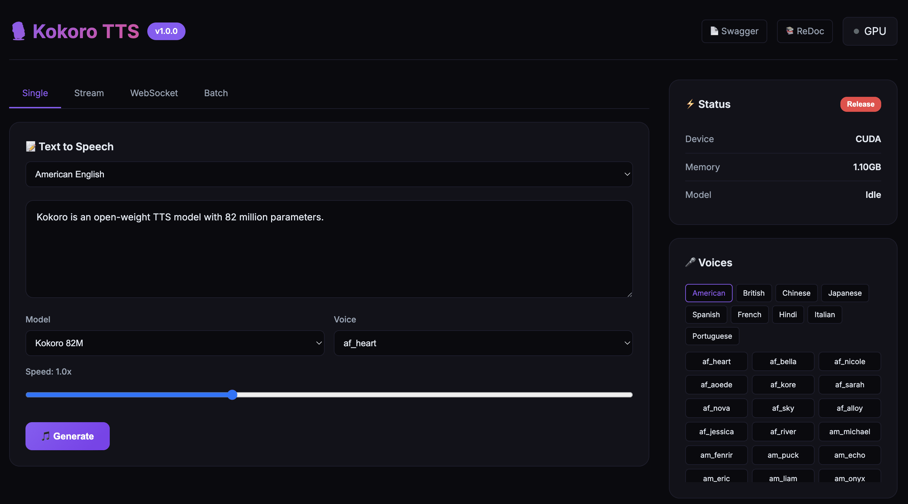

[English](README.md) | [简体中文](README_CN.md) | [繁體中文](README_TW.md) | [日本語](README_JP.md)

<div align="center">

# 🎙️ Kokoro TTS

[](https://hub.docker.com/r/neosun/kokoro-tts)
[](LICENSE)
[](https://python.org)
[](https://huggingface.co/hexgrad/Kokoro-82M)

**Kokoro-82M テキスト読み上げ All-in-One Docker イメージ**

Web UI • REST API • WebSocket • ストリーミング • バッチ処理 • MCP



</div>

---

## ✨ 機能

- 🎨 **美しい Web UI** - リアルタイム音声再生対応のモダンなインターフェース
- 🔌 **REST API** - Swagger ドキュメント付きの完全な HTTP エンドポイント
- 📡 **WebSocket** - リアルタイム双方向 TTS 通信
- 🌊 **ストリーミング** - 生成しながら音声を配信
- 📦 **バッチ処理** - 1回のリクエストで複数のテキストを処理
- 🤖 **MCP サーバー** - AI エージェント統合（Claude など）
- 🌍 **多言語対応** - 英語、中国語、日本語、スペイン語、フランス語、ヒンディー語、イタリア語、ポルトガル語
- 🚀 **GPU アクセラレーション** - CUDA 対応、自動メモリ管理
- 📱 **54+ ボイス** - 豊富な男女の音声

## 🚀 クイックスタート

```bash
docker run -d --name kokoro-tts --gpus all -p 8300:8300 neosun/kokoro-tts:latest
```

ブラウザで http://localhost:8300 を開きます。

## 📦 インストール

### 前提条件

- Docker 20.10+
- NVIDIA GPU（オプション、CPU でも動作可能）
- nvidia-docker2（GPU サポートに必要）

### Docker 実行

```bash
# GPU モード
docker run -d \
  --name kokoro-tts \
  --gpus all \
  -p 8300:8300 \
  -e GPU_IDLE_TIMEOUT=600 \
  --restart unless-stopped \
  neosun/kokoro-tts:latest

# CPU モード
docker run -d \
  --name kokoro-tts \
  -p 8300:8300 \
  --restart unless-stopped \
  neosun/kokoro-tts:latest
```

### Docker Compose

```yaml
services:
  kokoro-tts:
    image: neosun/kokoro-tts:latest
    container_name: kokoro-tts
    ports:
      - "8300:8300"
    environment:
      - GPU_IDLE_TIMEOUT=600
    deploy:
      resources:
        reservations:
          devices:
            - driver: nvidia
              count: 1
              capabilities: [gpu]
    restart: unless-stopped
```

```bash
docker-compose up -d
```

### インストール確認

```bash
# ヘルスチェック
curl http://localhost:8300/health

# 音声生成
curl -X POST http://localhost:8300/api/tts \
  -H "Content-Type: application/json" \
  -d '{"text":"こんにちは世界","voice":"jf_alpha"}' \
  -o output.wav
```

## ⚙️ 設定

| 変数 | デフォルト | 説明 |
|------|------------|------|
| `PORT` | `8300` | サーバーポート |
| `GPU_IDLE_TIMEOUT` | `300` | GPU メモリ解放までの秒数 |
| `NVIDIA_VISIBLE_DEVICES` | `all` | GPU デバイス選択 |

## 📖 使用方法

### Web UI

| タブ | 説明 |
|------|------|
| **Single** | 単一の音声ファイルを生成 |
| **Stream** | リアルタイムストリーミング再生 |
| **WebSocket** | 双方向リアルタイム TTS |
| **Batch** | 複数テキストのバッチ処理 |

### REST API

#### 音声生成（WAV）
```bash
curl -X POST http://localhost:8300/api/tts \
  -H "Content-Type: application/json" \
  -d '{"text":"こんにちは世界","voice":"jf_alpha","speed":1.0}' \
  -o output.wav
```

#### 音声生成（Base64）
```bash
curl -X POST http://localhost:8300/api/tts/base64 \
  -H "Content-Type: application/json" \
  -d '{"text":"こんにちは世界","voice":"jf_alpha","speed":1.0}'
```

#### ストリーミング
```bash
curl -X POST http://localhost:8300/api/tts/stream \
  -H "Content-Type: application/json" \
  -d '{"text":"長いテキストをここに...","voice":"jf_alpha"}'
```

#### バッチ処理
```bash
curl -X POST http://localhost:8300/api/tts/batch \
  -H "Content-Type: application/json" \
  -d '{
    "items": [
      {"id":"1","text":"最初の文","voice":"jf_alpha"},
      {"id":"2","text":"二番目の文","voice":"jm_kumo"}
    ]
  }'
```

### WebSocket

```javascript
const ws = new WebSocket('ws://localhost:8300/ws/tts');
ws.onopen = () => {
  ws.send(JSON.stringify({
    text: "こんにちは世界",
    voice: "jf_alpha",
    speed: 1.0
  }));
};
ws.onmessage = (e) => {
  const data = JSON.parse(e.data);
  if (data.status === 'chunk') {
    // 音声再生: data.audio (base64)
  }
};
```

### MCP 統合

```json
{
  "mcpServers": {
    "kokoro-tts": {
      "command": "docker",
      "args": ["exec", "-i", "kokoro-tts", "python", "/app/docker/server.py", "mcp"]
    }
  }
}
```

## 🎤 利用可能なボイス

### モデル

| モデル | 言語数 | ボイス数 | 用途 |
|--------|--------|----------|------|
| `hexgrad/Kokoro-82M` | 9 | 54 | 汎用 |
| `hexgrad/Kokoro-82M-v1.1-zh` | 3 | 103 | 中国語最適化 |

### ボイス例

| 言語 | 女性 | 男性 |
|------|------|------|
| 🇺🇸 アメリカ英語 | af_heart, af_bella, af_nicole | am_michael, am_fenrir |
| 🇬🇧 イギリス英語 | bf_emma, bf_isabella | bm_george, bm_fable |
| 🇨🇳 中国語 | zf_xiaobei, zf_xiaoyi | zm_yunjian, zm_yunyang |
| 🇯🇵 日本語 | jf_alpha, jf_tebukuro | jm_kumo |
| 🇪🇸 スペイン語 | ef_dora | em_alex |
| 🇫🇷 フランス語 | ff_siwis | - |

## 📚 API ドキュメント

- **Swagger UI**: http://localhost:8300/docs
- **ReDoc**: http://localhost:8300/redoc

## 🏗️ プロジェクト構成

```
kokoro/
├── docker/
│   ├── server.py        # FastAPI サーバー
│   ├── ui_template.py   # Web UI
│   └── mcp_server.py    # MCP ツール
├── kokoro/              # コア TTS ライブラリ
├── Dockerfile
├── docker-compose.yml
└── README.md
```

## 🛠️ 技術スタック

- **バックエンド**: FastAPI, Uvicorn
- **TTS エンジン**: Kokoro-82M (StyleTTS 2)
- **ディープラーニング**: PyTorch, CUDA
- **コンテナ**: Docker, NVIDIA Container Toolkit

## 🤝 コントリビューション

コントリビューションを歓迎します！お気軽に Pull Request を送ってください。

1. リポジトリをフォーク
2. 機能ブランチを作成 (`git checkout -b feature/amazing`)
3. 変更をコミット (`git commit -m '素晴らしい機能を追加'`)
4. ブランチにプッシュ (`git push origin feature/amazing`)
5. Pull Request を作成

## 📖 ドキュメント

- [ストリーミング遅延最適化ガイド](docs/STREAMING_OPTIMIZATION.md) - 遅延を 2s から 100ms に削減した方法

## 📝 変更履歴

### v1.1.0 (2024-12)
- ⚡ **ストリーミング遅延最適化** - 初回再生時間を 2s+ から ~100ms に短縮
  - 改行分割の代わりに文/節で分割し、より小さなチャンクを生成
  - 起動時のモデルウォームアップでコールドスタート遅延を解消
  - ブラウザ側でノンブロッキング音声デコード
  - ブラウザの自動再生ポリシーに対応した AudioContext 自動再開
- 📊 **パフォーマンス指標パネル** - Stream タブ
  - 最初のバイトまでの時間 (TTFB)
  - 再生開始時間
  - 合計時間
  - データサイズ
- 🎛️ **UI 改善**
  - Stream、WebSocket、Batch タブにモデル/ボイス/速度セレクターを追加
  - ストリーミング中のリアルタイム指標更新

### v1.0.0 (2024-12)
- 初回リリース
- 4つのタブを持つ Web UI（Single、Stream、WebSocket、Batch）
- 完全な REST API
- WebSocket リアルタイム TTS
- AI エージェント用 MCP サーバー
- マルチモデル対応（Kokoro-82M、v1.1-zh）
- 9言語 54+ ボイス

## 📄 ライセンス

このプロジェクトは Apache License 2.0 の下でライセンスされています - 詳細は [LICENSE](LICENSE) ファイルをご覧ください。

## 🙏 謝辞

- [hexgrad/Kokoro-82M](https://huggingface.co/hexgrad/Kokoro-82M) - 素晴らしい TTS モデル
- [StyleTTS 2](https://github.com/yl4579/StyleTTS2) - モデルアーキテクチャ

---

## ⭐ Star History

[](https://star-history.com/#neosun100/kokoro-tts)

## 📱 フォローする


