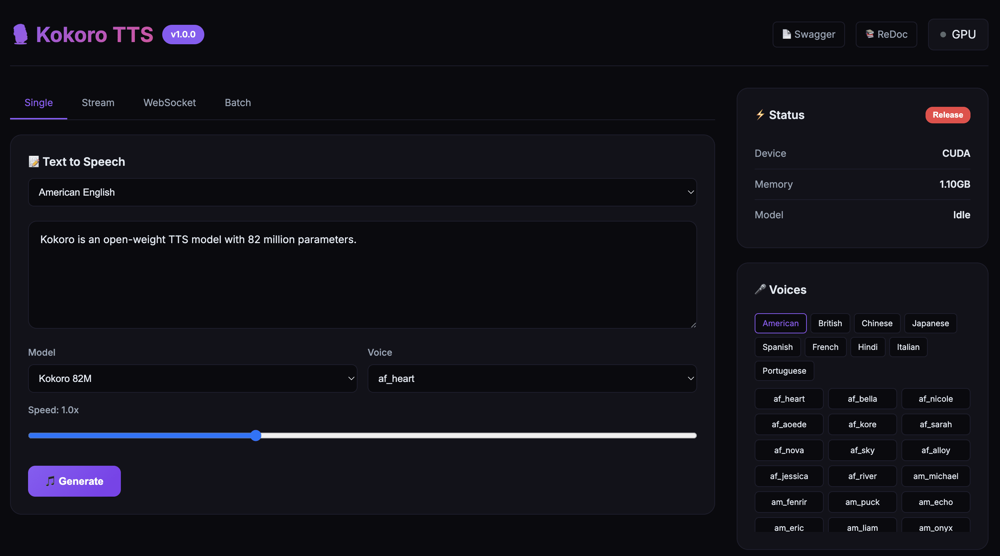

[English](README.md) | [简体中文](README_CN.md) | [繁體中文](README_TW.md) | [日本語](README_JP.md)

<div align="center">

# 🎙️ Kokoro TTS

[](https://hub.docker.com/r/neosun/kokoro-tts)
[](LICENSE)
[](https://python.org)
[](https://huggingface.co/hexgrad/Kokoro-82M)

**Kokoro-82M 文字轉語音 All-in-One Docker 映像檔**

Web UI • REST API • WebSocket • 串流傳輸 • 批次處理 • MCP



</div>

---

## ✨ 功能特色

- 🎨 **精美 Web UI** - 現代化介面，支援即時音訊播放
- 🔌 **REST API** - 完整的 HTTP 介面，附帶 Swagger 文件
- 📡 **WebSocket** - 即時雙向 TTS 通訊
- 🌊 **串流傳輸** - 邊生成邊播放音訊
- 📦 **批次處理** - 一次請求處理多段文字
- 🤖 **MCP 伺服器** - AI 代理整合（Claude 等）
- 🌍 **多語言支援** - 英語、中文、日語、西班牙語、法語、印地語、義大利語、葡萄牙語
- 🚀 **GPU 加速** - CUDA 支援，自動記憶體管理
- 📱 **54+ 語音** - 豐富的男女聲音選擇

## 🚀 快速開始

```bash
docker run -d --name kokoro-tts --gpus all -p 8300:8300 neosun/kokoro-tts:latest
```

在瀏覽器中開啟 http://localhost:8300

## 📦 安裝部署

### 前置條件

- Docker 20.10+
- NVIDIA GPU（可選，支援 CPU 執行）
- nvidia-docker2（GPU 支援需要）

### Docker 執行

```bash
# GPU 模式
docker run -d \
  --name kokoro-tts \
  --gpus all \
  -p 8300:8300 \
  -e GPU_IDLE_TIMEOUT=600 \
  --restart unless-stopped \
  neosun/kokoro-tts:latest

# CPU 模式
docker run -d \
  --name kokoro-tts \
  -p 8300:8300 \
  --restart unless-stopped \
  neosun/kokoro-tts:latest
```

### Docker Compose

```yaml
services:
  kokoro-tts:
    image: neosun/kokoro-tts:latest
    container_name: kokoro-tts
    ports:
      - "8300:8300"
    environment:
      - GPU_IDLE_TIMEOUT=600
      - KEEP_MODEL_LOADED=true  # 永不釋放模型
    deploy:
      resources:
        reservations:
          devices:
            - driver: nvidia
              count: 1
              capabilities: [gpu]
    restart: unless-stopped
```

```bash
docker-compose up -d
```

### 驗證安裝

```bash
# 健康檢查
curl http://localhost:8300/health

# 生成語音
curl -X POST http://localhost:8300/api/tts \
  -H "Content-Type: application/json" \
  -d '{"text":"你好世界","voice":"zf_xiaobei"}' \
  -o output.wav
```

## ⚙️ 設定說明

| 變數 | 預設值 | 說明 |
|------|--------|------|
| `PORT` | `8300` | 服務埠號 |
| `GPU_IDLE_TIMEOUT` | `300` | GPU 閒置釋放時間（秒） |
| `KEEP_MODEL_LOADED` | `false` | 永不釋放模型（設為 `true` 獲得最低延遲） |
| `NVIDIA_VISIBLE_DEVICES` | `all` | GPU 裝置選擇 |

## 📖 使用方法

### Web UI

| 標籤頁 | 說明 |
|--------|------|
| **Single** | 生成單一音訊檔案 |
| **Stream** | 即時串流播放 |
| **WebSocket** | 雙向即時 TTS |
| **Batch** | 批次處理多段文字 |

### REST API

#### 生成語音（WAV）
```bash
curl -X POST http://localhost:8300/api/tts \
  -H "Content-Type: application/json" \
  -d '{"text":"你好世界","voice":"zf_xiaobei","speed":1.0}' \
  -o output.wav
```

#### 生成語音（Base64）
```bash
curl -X POST http://localhost:8300/api/tts/base64 \
  -H "Content-Type: application/json" \
  -d '{"text":"你好世界","voice":"zf_xiaobei","speed":1.0}'
```

#### 串流傳輸
```bash
curl -X POST http://localhost:8300/api/tts/stream \
  -H "Content-Type: application/json" \
  -d '{"text":"這是一段很長的文字...","voice":"zf_xiaobei"}'
```

#### 批次處理
```bash
curl -X POST http://localhost:8300/api/tts/batch \
  -H "Content-Type: application/json" \
  -d '{
    "items": [
      {"id":"1","text":"第一句","voice":"zf_xiaobei"},
      {"id":"2","text":"第二句","voice":"zm_yunjian"}
    ]
  }'
```

### WebSocket

```javascript
const ws = new WebSocket('ws://localhost:8300/ws/tts');
ws.onopen = () => {
  ws.send(JSON.stringify({
    text: "你好世界",
    voice: "zf_xiaobei",
    speed: 1.0
  }));
};
ws.onmessage = (e) => {
  const data = JSON.parse(e.data);
  if (data.status === 'chunk') {
    // 播放音訊: data.audio (base64)
  }
};
```

### MCP 整合

```json
{
  "mcpServers": {
    "kokoro-tts": {
      "command": "docker",
      "args": ["exec", "-i", "kokoro-tts", "python", "/app/docker/server.py", "mcp"]
    }
  }
}
```

## 🎤 可用語音

### 模型

| 模型 | 語言數 | 語音數 | 適用場景 |
|------|--------|--------|----------|
| `hexgrad/Kokoro-82M` | 9 | 54 | 通用場景 |
| `hexgrad/Kokoro-82M-v1.1-zh` | 3 | 103 | 中文最佳化 |

### 語音範例

| 語言 | 女聲 | 男聲 |
|------|------|------|
| 🇺🇸 美式英語 | af_heart, af_bella, af_nicole | am_michael, am_fenrir |
| 🇬🇧 英式英語 | bf_emma, bf_isabella | bm_george, bm_fable |
| 🇨🇳 中文 | zf_xiaobei, zf_xiaoyi | zm_yunjian, zm_yunyang |
| 🇯🇵 日語 | jf_alpha, jf_tebukuro | jm_kumo |
| 🇪🇸 西班牙語 | ef_dora | em_alex |
| 🇫🇷 法語 | ff_siwis | - |

## 📚 API 文件

- **Swagger UI**: http://localhost:8300/docs
- **ReDoc**: http://localhost:8300/redoc

## 🏗️ 專案結構

```
kokoro/
├── docker/
│   ├── server.py        # FastAPI 伺服器
│   ├── ui_template.py   # Web UI
│   └── mcp_server.py    # MCP 工具
├── kokoro/              # 核心 TTS 函式庫
├── Dockerfile
├── docker-compose.yml
└── README.md
```

## 🛠️ 技術棧

- **後端**: FastAPI, Uvicorn
- **TTS 引擎**: Kokoro-82M (StyleTTS 2)
- **深度學習**: PyTorch, CUDA
- **容器化**: Docker, NVIDIA Container Toolkit

## 🤝 貢獻指南

歡迎貢獻！請隨時提交 Pull Request。

1. Fork 本倉庫
2. 建立功能分支 (`git checkout -b feature/amazing`)
3. 提交變更 (`git commit -m '新增功能'`)
4. 推送到分支 (`git push origin feature/amazing`)
5. 建立 Pull Request

## 📖 文件

- [串流延遲優化指南](docs/STREAMING_OPTIMIZATION.md) - 如何將延遲從 2s 降低到 50ms

## 📝 更新日誌

### v1.1.1 (2025-01) - 🔒 模型常駐記憶體

**🆕 新功能**
- 新增 `KEEP_MODEL_LOADED` 環境變數
- 設為 `true` 時，模型永久駐留 GPU 記憶體
- 完全消除冷啟動延遲，穩定 51ms TTFB

**📊 最新效能數據 (2025-01-29)**
- 本地 TTFB：**51-53ms**（穩定）
- Cloudflare TTFB：**138-178ms**
- 首 Chunk：**54ms, 71.5KB**

### v1.1.0 (2025-01) - 🚀 串流延遲優化

**⚡ 重大效能提升**
- **首播速度提升 40 倍** - 從 2s+ 降低到 ~50ms
- **首 Chunk 縮小 6 倍** - 從 436KB 降低到 71.5KB
- **TTFB 提升 10 倍** - 從 ~500ms 降低到 ~50ms（本地）

**🔧 後端優化**
- 按句子/子句分割音訊（`[.!?。！？,，;；:：]+`）替代換行分割
- 啟動時模型預熱 - 消除冷啟動延遲（93ms → 56ms）
- 新增 `X-Accel-Buffering: no` 和 `Cache-Control: no-cache` 回應標頭
- 串流 chunk 按句子生成，立即發送

**🎨 前端優化**
- 非阻塞音訊解碼：使用 `.then()` 替代 `await`
- AudioContext 自動恢復，處理瀏覽器自動播放策略
- 首個 chunk 解碼完成立即播放
- chunk 接收和音訊解碼並行處理

**📊 效能指標面板**（Stream 標籤頁）
- 首字節延遲 (TTFB) - 測量伺服器回應時間
- 開始播放時間 - 測量實際音訊開始時間
- 總時間 - 即時計時器
- 資料大小 - 接收的總位元組數

**🎛️ UI 增強**
- Stream、WebSocket、Batch 標籤頁新增模型選擇器
- Stream、WebSocket、Batch 標籤頁新增語音選擇器
- Stream、WebSocket、Batch 標籤頁新增速度滑桿
- 串流傳輸過程中即時更新指標
- 改進狀態指示器和提示通知

**🐛 Bug 修復**
- 修復 WebSocket `sendWS()` 使用錯誤的模型選擇器
- 修復 Batch 標籤頁缺少音訊播放控制項
- 修復 UI 底部版本號顯示

### v1.0.0 (2025-01) - 🎉 首次發布

**✨ 核心功能**
- 精美 Web UI，支援 4 個標籤頁（Single、Stream、WebSocket、Batch）
- 完整 REST API，帶 Swagger/ReDoc 文件
- WebSocket 即時雙向 TTS
- 串流音訊傳輸，邊生成邊發送
- 批次處理多個文字

**🤖 AI 整合**
- MCP 伺服器，支援 AI 代理整合（Claude、Cursor 等）
- 基於工具的 TTS 生成，適用於 AI 工作流程

**🌍 多語言支援**
- 9 種語言：英語、中文、日語、西班牙語、法語、印地語、義大利語、葡萄牙語、韓語
- 54+ 語音，包含男聲和女聲
- 多模型支援：Kokoro-82M（通用）和 Kokoro-82M-v1.1-zh（中文優化）

**🚀 基礎設施**
- GPU 加速，支援 CUDA
- 自動 GPU 記憶體管理，可設定閒置逾時
- GPU 不可用時自動回退到 CPU
- Docker 容器化部署

### v1.0.0 (2025-01) - 🎉 首次發布

**✨ 核心功能**
- 精美 Web UI，支援 4 個標籤頁（Single、Stream、WebSocket、Batch）
- 完整 REST API，帶 Swagger/ReDoc 文件
- WebSocket 即時雙向 TTS
- 串流音訊傳輸，邊生成邊發送
- 批次處理多個文字

**🤖 AI 整合**
- MCP 伺服器，支援 AI 代理整合（Claude、Cursor 等）
- 基於工具的 TTS 生成，適用於 AI 工作流程

**🌍 多語言支援**
- 9 種語言：英語、中文、日語、西班牙語、法語、印地語、義大利語、葡萄牙語、韓語
- 54+ 語音，包含男聲和女聲
- 多模型支援：Kokoro-82M（通用）和 Kokoro-82M-v1.1-zh（中文優化）

**🚀 基礎設施**
- GPU 加速，支援 CUDA
- 自動 GPU 記憶體管理，可設定閒置逾時
- GPU 不可用時自動回退到 CPU
- Docker 容器化部署

## 📄 授權條款

本專案採用 Apache License 2.0 授權 - 詳見 [LICENSE](LICENSE) 檔案。

## 🙏 致謝

- [hexgrad/Kokoro-82M](https://huggingface.co/hexgrad/Kokoro-82M) - 優秀的 TTS 模型
- [StyleTTS 2](https://github.com/yl4579/StyleTTS2) - 模型架構

---

## ⭐ Star History

[](https://star-history.com/#neosun100/kokoro-tts)

## 📱 關注公眾號


